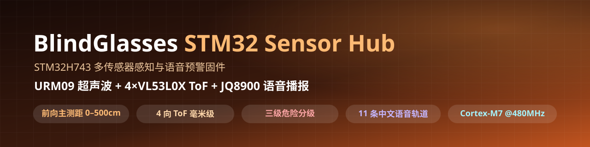
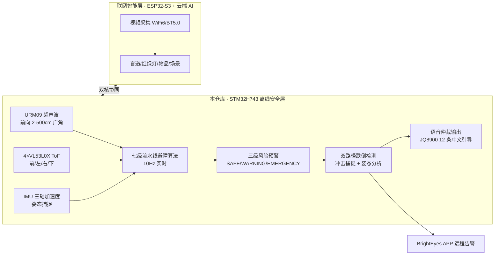

<div align="center">
  
</div>

<p align="center">
  
  
  
  
</p>

> **⚠️ 免责声明**：本项目仅为交流学习使用，请勿直接给视障人群使用。

---

## 📌 项目定位

**明眸 BrightEyes AI 全域智能导盲眼镜**的**离线安全层**：以 **STM32H743** 为主控核心，融合 **URM09 超声波 + 4×VL53L0X ToF（前/左/右/下）+ IMU 三轴加速度**，运行自研**七级流水线避障算法**，实现**三级风险预警**、**双路径跌倒检测**与**12 条标准化中文语音引导**——**本地闭环运行，无需网络，毫秒级响应**，全天候保障视障用户的基础出行安全。

## 🔗 双核协同（本仓库在双模架构中的位置）

本仓库是明眸 BrightEyes **双核异构架构**（STM32H743 主控 + ESP32-S3 通信）的**离线安全层**，与 [联网智能层（OpenAIglasses_for_Navigation）](https://github.com/3072963Charles/OpenAIglasses_for_Navigation) 协同工作、不可分割：

| 层级 | 主控 | 职责 | 运行方式 |
|------|------|------|----------|
| ⚡ **离线安全层（本仓库）** | STM32H743 | 传感器感知 · 避障决策 · 语音预警 · 跌倒检测 | 本地闭环 · 始终在线 · **无需网络** |
| 🌐 **联网智能层** | ESP32-S3 | 视频采集 · 云端 AI 视觉理解 · 场景认知 | 连接手机网络时激活 |

- **双核异构**：主控与通信分离，保障实时性与扩展性
- **多传感冗余融合**：激光 + 超声波互补，全天候精准感知
- **软硬解耦设计**：标准化接口，支持算法与硬件独立迭代



---

## 🎯 核心能力

### 全域无盲区环境感知（360°）

| 探测方向 | 传感器 | 参数 | 用途 |
|---------|--------|------|------|
| 前方（双模态融合） | URM09 超声波 + VL53L0X ToF | 2–500 cm 广角 + 5–2000 mm 高精 | 远距宏观扫描 + 近距精确测距 |
| 左侧（镜腿） | VL53L0X ToF | mm 级 | 侧向障碍、狭窄通道 |
| 右侧（镜腿） | VL53L0X ToF | mm 级 | 行人夹击、侧向碰撞风险 |
| 地面（鼻托下方） | VL53L0X ToF | 35°–45° 俯角直扫 | 台阶 / 坑洞 / 悬空落差检测 |

### 七级流水线避障算法（自研）

```
① 数据采集 → ② 数据预处理(滤波去噪/校准) → ③ 状态判断 → ④ 风险融合(多源统一建模)
→ ⑤ 路径决策(最优通行) → ⑥ 语音仲裁(最高优先级) → ⑦ 结果输出(播报/数据上传)
```

- 运行频率 **10Hz** · 响应 **毫秒级** · 核心策略：优先级动态调度
- 智能优先级仲裁：多指令冲突时自动筛选最高风险、最高价值指令
- 防语音轰炸机制：过滤冗余信息，避免用户听觉过载

### 三级风险预警

| 等级 | 颜色 | 指令 | 场景 |
|------|------|------|------|
| EMERGENCY | 🔴 红色紧急 | "立即停止" | 障碍物极近、直接碰撞风险 |
| WARNING | 🟡 黄色注意 | "减速观察" | 中距离障碍，提前避让 |
| SAFE | 🟢 绿色安全 | "可以通行" | 风险解除确认 |

- **0 认知负担** · **3 大类标准化等级** · **100% 关键风险覆盖**

### 双路径跌倒检测

| 路径 | 判定条件 | 特点 |
|------|----------|------|
| 路径一：突发冲击检测 | 加速度 > 3g 且设备倾斜角 > 60° | 瞬时识别强冲击 / 意外掉落，立即报警 |
| 路径二：异常姿态分析 | 异常倾斜姿态持续 2 秒 | 过滤弯腰、下蹲等日常动作，**0 误报** |

- 全链路闭环：智能识别 → 本地声光报警 → APP 端推送 → 家属端紧急触达
- **2 秒**姿态报警延迟确认 · **0 误报**日常动作过滤 · **100%** 真实险情响应率

### 12 条标准化中文语音引导（JQ8900）

| Track | 内容 | 优先级 |
|-------|------|--------|
| 1 | 前方危险，请停下 | P0 紧急 |
| 2 | 前方注意 | P1 注意 |
| 3 | 左侧有障碍，请向右 | P0 紧急 |
| 4 | 左侧注意 | P1 注意 |
| 5 | 右侧有障碍，请向左 | P0 紧急 |
| 6 | 右侧注意 | P1 注意 |
| 7 | 注意脚下，有台阶 | P0 紧急 |
| 8 | 前方安全，可以通行 | P2 安全 |
| 9 | 前方受阻，请停下 | P0 紧急 |
| 10 | 两侧狭窄，小心通过 | P1 注意 |
| 11 | 下方注意 | P1 注意 |

> 其余为跌倒告警、状态恢复等场景指令，共同构成**12 条标准化语音引导体系**。语音仲裁：P0 紧急可抢占播放、同优先级排队、全局静默间隔（800 ms）、按方向冷却（2 s）。

---

## 🧑‍💻 我的工作

| 阶段 | 工作内容 |
|------|----------|
| 🏗️ 硬件架构 | 双核异构系统设计（主控/通信分离）；传感器选型与 360° 布局（超声 + 四向 ToF + IMU） |
| 💻 驱动开发 | STM32H743 HAL 驱动从零实现：URM09（I2C3）、VL53L0X（I2C2 四路 XSHUT）、IMU（三轴姿态）、JQ8900（USART2 指令协议） |
| 🧠 避障算法 | 自研**七级流水线**：数据采集→预处理→状态判断→风险融合→路径决策→语音仲裁→输出 |
| 🎙️ 语音仲裁 | 三级优先级抢占 / 排队 / 方向冷却 / 防语音轰炸，12 条中文引导轨道 |
| 🚨 跌倒检测 | 双路径算法：冲击捕捉（>3g 且倾角>60°）+ 异常姿态（2s 确认），0 误报甄别 |
| 🔧 工程构建 | STM32CubeMX + CMake / Ninja / arm-none-eabi 工具链配置 |
| 🧪 联调验证 | 与 ESP32-S3 联网层双核协同联调；城市道路 / 路口 / 台阶 / 居家四场景实机验证 |

**🧭 工作领域**：嵌入式系统 · 多传感器融合 · 实时决策算法 · 语音交互 · 硬件安全兜底

---

## 🎓 学到了什么

| 方向 | 收获 |
|------|------|
| MCU 开发 | STM32H743（Cortex-M7 @480MHz）HAL 驱动、时钟树与外设配置 |
| 传感器驱动 | URM09 超声波 I2C 测距、VL53L0X ToF 多路复用、IMU 姿态解算、JQ8900 串口指令 |
| 算法工程 | 七级流水线状态机、多源数据融合建模、优先级动态调度、防抖滤波 |
| 系统工程 | 双核异构（主控/通信分离）、软硬解耦、离线兜底设计（不依赖网络的低延迟保障） |

---

## 🧰 工具链

<p align="center">
  
  
  
  
  
  
</p>

---

## 🏆 主要成果

- 🤖 **从零开发**的 STM32H743 离线安全层固件（驱动 → 七级流水线 → 语音全链路）
- 🎙️ **12 条标准化中文语音引导** + 三级风险预警 + 优先级抢占仲裁
- 🚨 **双路径跌倒检测**：冲击捕捉 + 姿态分析，0 误报、100% 真实险情响应
- ⚡ **10Hz 实时运行 · 毫秒级响应 · 本地闭环**，硬件级安全兜底（无需网络）
- 🧩 与 ESP32-S3 联网层组成**双模架构**，获中国高校计算机大赛 **海南省二等奖**

---

## 📁 目录结构

```
blindglasses_stm32/
├── Core/
│   ├── Inc/                  # 头文件
│   │   ├── main.h / gpio.h / i2c.h / usart.h
│   │   ├── urm09_v3.h        # URM09 超声波驱动
│   │   ├── vl53l0x.h         # VL53L0X ToF 驱动（4 路）
│   │   ├── jq8900.h          # JQ8900 语音模块驱动
│   │   └── obstacle.h        # 障碍物决策引擎
│   └── Src/
│       ├── main.c            # 主程序（初始化 + 100ms 轮询）
│       ├── urm09_v3.c / vl53l0x.c / jq8900.c
│       ├── obstacle.c        # 多传感器融合判定 + 语音仲裁
│       └── ...
├── Drivers/                  # CMSIS + STM32H7xx HAL 库
├── cmake/                    # gcc-arm-none-eabi 工具链文件
├── CMakeLists.txt
├── CMakePresets.json         # Debug / Release（Ninja）
├── URM09_TOF_CubeIDE.ioc     # STM32CubeMX 工程文件
├── startup_stm32h743xx.s
└── STM32H743XG_FLASH.ld
```

---

## 🔨 构建方式

**方式一：STM32CubeIDE**
直接打开 `URM09_TOF_CubeIDE.ioc` 或导入工程编译烧录。

**方式二：CMake + arm-none-eabi-gcc**

```bash
cmake --preset Debug        # 或 Release
cmake --build --preset Debug
```

产物位于 `build/Debug/`。

---

## 🔌 主要接口

| 接口 | 说明 |
|------|------|
| `URM09_V3_Init / ReadDistance` | 超声波初始化与距离读取（cm） |
| `VL53L0X_InitAll / ReadAll` | 4 路 ToF 初始化与批量读取（mm） |
| `IMU_Init / ReadAccel` | 三轴加速度姿态捕捉 |
| `JQ8900_Init / Play / Stop / SetVolume` | 语音播报控制 |
| `Obstacle_Process(dist_cm, tof_mm)` | 每周期调用：多传感器融合判定 + 语音仲裁 |
| `Obstacle_GetLevel` | 获取全局危险等级（1=DANGER 2=WARNING 3=SAFE） |

---

## 📄 许可

本项目仅供学术研究与交流使用。

---

*Author: Charles (Zonkit) · 明眸 BrightEyes 智能导盲眼镜 · 离线安全层（STM32H743）*
