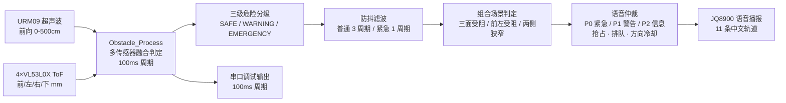

<div align="center">
  
</div>

<p align="center">
  
  
  
  
</p>

> **⚠️ 免责声明**：本项目仅为交流学习使用，请勿直接给视障人群使用。

---

## 📌 项目定位

**明眸 BrightEyes 智能导盲眼镜**的硬件感知子系统：以 **STM32H743** 为核心，融合 **URM09 超声波测距 + 4×VL53L0X ToF 激光测距（前/左/右/下四向）**，通过**多级危险分级**与**语音仲裁**，用 **JQ8900 语音模块**实时向视障用户播报前方障碍、台阶与通行安全提示。

**🎯 项目做了什么**：将多传感器原始距离数据转换为**分方向、分等级的中文语音预警**，为软件端（AI 视觉导航）提供独立、低延迟的硬件安全兜底层。

---

## 🔌 传感器布局

| 传感器 | 数量 | 总线 | 引脚 | 用途 |
|--------|------|------|------|------|
| URM09 V3 超声波测距 | 1 | I2C3 | PA8 / PC9 | 前向主测距（cm，0–500 cm） |
| VL53L0X ToF 激光测距 | 4 | I2C2 | PB10 / PB11（XSHUT: PE0–PE3） | 前 S0 / 左 S1 / 右 S2 / 下 S3（mm） |
| JQ8900-16P 语音播报 | 1 | USART2 | PD5（9600 baud 8N1） | 中文语音预警（11 条轨道） |

- **前向（S0）**：与 URM09 互补，近距离精确测距
- **左/右（S1/S2）**：两侧障碍物检测
- **底部（S3）**：台阶 / 陡坡 / 不平地面检测

### 数据流



---

## ⚙️ 功能特性

- **三级危险分级**：SAFE / WARNING / EMERGENCY，按方向独立判定
  - ToF 阈值：紧急 < 30 cm，警告 < 80 cm
  - URM09 阈值：紧急 < 50 cm，警告 < 200 cm
  - 底部阈值：紧急 < 50 cm，警告 < 100 cm
- **动态风险升级**：距离持续递减时 Warning 自动升级为 Emergency
- **防抖滤波**：普通告警 3 周期（300 ms）确认，紧急告警 1 周期（100 ms）
- **语音仲裁系统**：
  - 三级优先级（P0 紧急 / P1 警告 / P2 信息），高优先级可抢占播放
  - 同优先级排队、全局静默间隔（800 ms）、按方向冷却（2 s）
  - 紧急复发 500 ms、危险等级重复播报 3 s
- **组合场景判定**：三面受阻、前左受阻、前右受阻、两侧狭窄等
- **智能引导提示**：如"右侧安全，可向右转""左侧通畅，建议向左转"
- **等级切换播报**：进入 / 脱离危险状态自动播报（如"前方安全，可以通行"）
- **串口调试**：100 ms 周期输出 `URM09(cm) | ToF(mm): Front Left Right Bot` + 分区状态标记

## 🎵 语音轨道（JQ8900 根目录 /01.mp3 ~ /11.mp3）

| Track | 内容 | 优先级 |
|-------|------|--------|
| 1 | 前方危险，请停下 | P0 |
| 2 | 前方注意 | P1 |
| 3 | 左侧有障碍，请向右 | P0 |
| 4 | 左侧注意 | P1 |
| 5 | 右侧有障碍，请向左 | P0 |
| 6 | 右侧注意 | P1 |
| 7 | 注意脚下，有台阶 | P0 |
| 8 | 前方安全，可以通行 | P2 |
| 9 | 前方受阻，请停下 | P0 |
| 10 | 两侧狭窄，小心通过 | P1 |
| 11 | 下方注意 | P1 |

---

## 🧑‍💻 我的工作

| 阶段 | 工作内容 |
|------|----------|
| 🏗️ 硬件架构 | 传感器选型与布局（URM09 + 4×VL53L0X 四向 + JQ8900）、I2C / USART 总线分配 |
| 💻 驱动开发 | STM32H743 HAL 驱动从零实现：URM09（I2C3）、VL53L0X（I2C2 四路 XSHUT 控制）、JQ8900（USART2 指令协议） |
| 🧠 决策引擎 | `obstacle.c`：三级危险分级、动态风险升级、防抖滤波、组合场景判定 |
| 🎙️ 语音仲裁 | 三级优先级抢占 / 排队 / 方向冷却 / 静默间隔，11 条中文预警轨道管理 |
| 🔧 工程构建 | STM32CubeMX 工程 + CMake / Ninja / arm-none-eabi 工具链配置 |
| 🧪 联调验证 | 与软件端（FastAPI + ESP32-CAM）联调，实机距离与播报验证 |

**🧭 工作领域**：嵌入式系统 · 多传感器融合 · 实时语音交互 · 硬件安全兜底

---

## 🎓 学到了什么

| 方向 | 收获 |
|------|------|
| MCU 开发 | STM32H743（Cortex-M7 @480MHz）HAL 驱动开发、时钟树与 GPIO / I2C / USART 外设配置 |
| 传感器驱动 | URM09 超声波（I2C 测距协议）、VL53L0X ToF（XSHUT 多路复用 + 测量模式配置）、JQ8900 串口指令协议 |
| 嵌入式工程 | STM32CubeMX + CMake + Ninja 现代构建流程、链接脚本与启动文件 |
| 算法工程 | 多传感器融合判定、防抖滤波（多周期确认）、有限状态决策、优先级仲裁 |
| 系统工程 | 硬件端作为 AI 系统的"安全兜底层"设计——低延迟、不依赖网络、断电可用的保障策略 |

---

## 🧰 工具链

<p align="center">
  
  
  
  
  
  
</p>

---

## 🏆 主要成果

- 🤖 **从零开发**的 STM32H743 多传感器融合固件（驱动 → 决策 → 语音全链路）
- 🎙️ **三级危险分级** + **11 条中文语音预警轨道** + 优先级抢占仲裁
- ⚡ **100ms 决策周期**，硬件级安全兜底（不依赖网络与云端）
- 🧩 与软件端（明眸 BrightEyes AI 导航）组成完整的软硬件一体化系统

---

## 📁 目录结构

```
blindglasses_stm32/
├── Core/
│   ├── Inc/                  # 头文件
│   │   ├── main.h / gpio.h / i2c.h / usart.h
│   │   ├── urm09_v3.h        # URM09 超声波驱动
│   │   ├── vl53l0x.h         # VL53L0X ToF 驱动（4 路）
│   │   ├── jq8900.h          # JQ8900 语音模块驱动
│   │   └── obstacle.h        # 障碍物决策引擎
│   └── Src/
│       ├── main.c            # 主程序（初始化 + 100ms 轮询）
│       ├── urm09_v3.c / vl53l0x.c / jq8900.c
│       ├── obstacle.c        # 多传感器融合判定 + 语音仲裁
│       └── ...
├── Drivers/                  # CMSIS + STM32H7xx HAL 库
├── cmake/                    # gcc-arm-none-eabi 工具链文件
├── CMakeLists.txt
├── CMakePresets.json         # Debug / Release（Ninja）
├── URM09_TOF_CubeIDE.ioc     # STM32CubeMX 工程文件
├── startup_stm32h743xx.s
└── STM32H743XG_FLASH.ld
```

---

## 🔨 构建方式

**方式一：STM32CubeIDE**
直接打开 `URM09_TOF_CubeIDE.ioc` 或导入工程编译烧录。

**方式二：CMake + arm-none-eabi-gcc**

```bash
cmake --preset Debug        # 或 Release
cmake --build --preset Debug
```

产物位于 `build/Debug/`。

---

## 🔌 主要接口

| 接口 | 说明 |
|------|------|
| `URM09_V3_Init / ReadDistance` | 超声波初始化与距离读取（cm） |
| `VL53L0X_InitAll / ReadAll` | 4 路 ToF 初始化与批量读取（mm） |
| `JQ8900_Init / Play / Stop / SetVolume` | 语音播报控制 |
| `Obstacle_Process(dist_cm, tof_mm)` | 每周期调用：多传感器融合判定 + 语音仲裁 |
| `Obstacle_GetLevel` | 获取全局危险等级（1=DANGER 2=WARNING 3=SAFE） |

---

## 📄 许可

本项目仅供学术研究与交流使用。

---

*Author: Charles (Zonkit) · 明眸 BrightEyes 智能导盲眼镜硬件端*
